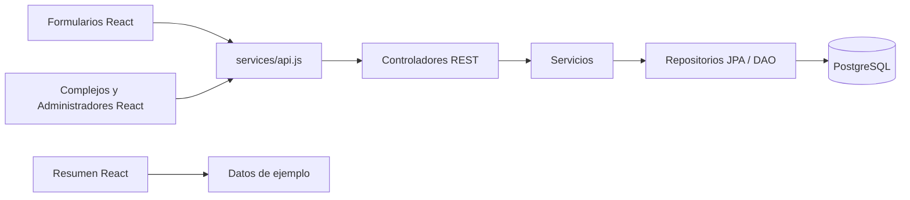

# Documentación técnica de Sportify

Fecha de revisión: 6 de octubre de 2026. Autoría: Equipo Sportify. El contenido se basa en el código del repositorio. La [guía de usuarios y acceso](ITERACION_3_USUARIOS.md) describe la actualización de la iteración 3 y su instalación.

## Arquitectura

El frontend React usa React Router para las pantallas y `fetch` para registro, acceso y solicitud de recuperación. El backend Spring Boot recibe HTTP en controladores, delega reglas en servicios y utiliza interfaces Spring Data JPA como capa DAO. Las entidades se mapean a PostgreSQL.



La recuperación figura en el cliente HTTP, pero no tiene controlador. Complejos consulta `GET /api/complejos` y registra con `POST /api/complejos`; búsqueda y filtros se aplican a la respuesta. Detalles, edición y cambio de estado siguen pendientes. Administradores consulta complejos, usuarios y asociaciones; permite asociar y retirar relaciones mediante los endpoints existentes. El resumen general conserva métricas y actividad de ejemplo.

## Responsabilidades del núcleo

| Capa | Elementos | Responsabilidad |
| --- | --- | --- |
| Controladores | `AuthController`, `ComplejoController`, `AdministradorComplejoController`, `UsuarioController` | Rutas, cuerpos de entrada y respuestas HTTP |
| Servicios | `AuthService`, `ComplejoService`, `AdministradorComplejoService` | Registro, validación de credenciales y gestión de asociaciones |
| Repositorios / DAO | `UsuarioRepository`, `RolRepository`, `UsuarioRolRepository`, `ComplejoRepository`, `AdministradorComplejoRepository` | Consultas derivadas e infraestructura de persistencia |
| Modelos | `Usuario`, `Rol`, `UsuarioRol`, `Complejo`, `AdministradorComplejo` y clases de clave | Mapeo de tablas e identidades |

Los controladores, servicios y repositorios del núcleo documentan sus contratos con Javadoc. Los métodos heredados de `JpaRepository` conservan su contrato de biblioteca. La referencia se genera en [javadoc/index.html](javadoc/index.html).

## Componentes reutilizables del frontend

Los formularios `Login`, `Registro`, `RecuperarContra` e `IngresaContraNueva` componen su interfaz con los mismos elementos de `frontend/src/components/ui/` y `frontend/src/components/auth/`.

| Componente | Responsabilidad | Propiedades principales |
| --- | --- | --- |
| `Button` | Botón nativo con variantes y bloqueo durante el envío | `variant`, `type`, `loading`, `loadingLabel`, `disabled`, `endIcon`, `children` |
| `FormField` | Etiqueta, entrada, icono opcional y error asociado | `label`, `icon`, `error` y atributos nativos del input |
| `StatusMessage` | Error con `role="alert"` o confirmación con `role="status"` | `message`, `type="error"` o `"exito"` |
| `FormIcon` | Trazos SVG originales de los formularios | `name`: `email`, `user`, `phone`, `lock`, `confirm`, `arrow` |
| `AuthHeader` | Marca Sportify y descripción | `description`, `titleId` |
| `AuthLayout` | Fondo, tarjeta, cabecera y pie opcional | `title`, `description`, `registration`, `footer`, `children` |

Las validaciones, estado y llamadas a la API permanecen en cada pantalla. Los componentes visuales no conocen endpoints ni redirigen al usuario. `Button` usa `type="button"` por defecto: los botones de envío deben declarar `type="submit"`. `FormField` genera un ID único si no se proporciona uno y conserva `required`, `pattern`, `minLength`, `autoComplete` y eventos nativos. Su error se conecta al campo con `aria-describedby` y `aria-invalid`.

Ejemplo de composición dentro de un formulario:

```jsx
<FormField
  label="Correo electrónico"
  name="correo"
  type="email"
  autoComplete="email"
  value={correo}
  onChange={(event) => setCorreo(event.target.value)}
  icon={<FormIcon name="email" />}
  required
/>
<Button type="submit" loading={enviando} loadingLabel="Guardando...">
  Guardar
</Button>
<StatusMessage message={mensaje} type="exito" />
```

`styles/global.css` mantiene la paleta, tipografías y variantes de botón. Los estilos base de campos y mensajes viven junto a sus componentes; `Login.css` y `Registro.css` conservan los ajustes del diseño de autenticación. La aplicación carga las variables globales desde `main.jsx`. La cabecera del panel sigue compartida mediante `DashboardLayout`.

Ejecutar `npm test` desde `frontend` para verificar bloqueo de botones, etiquetas y errores accesibles, restricciones nativas y renderizado de las cuatro pantallas. Estas pruebas no verifican la apariencia en navegador ni la conectividad del backend.

## Configuración

| Variable / propiedad | Uso |
| --- | --- |
| `VITE_API_URL` | URL del cliente HTTP; valor por defecto `http://localhost:8080/api` |
| `DB_URL` | JDBC PostgreSQL; por defecto `jdbc:postgresql://localhost:5432/sportify_bd` |
| `DB_USERNAME` | Usuario de base; obligatorio al usar variables |
| `DB_PASSWORD` | Contraseña de base; obligatoria al usar variables |
| Perfil `local` | Permite usar `application-local.properties`, copiado de la plantilla de ejemplo |
| `spring.jpa.hibernate.ddl-auto=none` | El esquema se prepara fuera de Hibernate |

El backend permite CORS únicamente desde `http://localhost:5173`. El frontend iniciado en otra dirección o puerto necesita una modificación de configuración del backend para acceder a la API.

## Base de datos

Las tablas y los scripts SQL están en desarrollo. Los siguientes campos quedan preparados para completar cuando el equipo defina el esquema oficial:

| Dato pendiente | Valor |
| --- | --- |
| Versión de PostgreSQL | 18.6 observado en el entorno local; confirmar versión del entorno oficial de entrega |
| Diagrama o documento del esquema definitivo | No está en el repositorio; falta el documento oficial del equipo |
| Tablas definitivas y descripción | Las entidades Java actuales mapean las tablas descritas abajo; falta confirmar que ese mapeo sea el esquema definitivo |
| Columnas, tipos y restricciones | El repositorio no contiene el DDL oficial; faltan los tipos y restricciones exactos de PostgreSQL |
| Claves primarias, foráneas y relaciones | Se conocen las identidades mapeadas por JPA; faltan las constraints oficiales del esquema |
| Script de creación del esquema y tablas | Falta versionar el esquema completo del equipo; los SQL nuevos actualizan una base existente |
| Script de actualización y roles | `backend/sportify-backend/sql/002_usuarios_acceso.sql` |
| Primer administrador y orden de instalación | Consultar [Iteración 3](ITERACION_3_USUARIOS.md) |

La tabla siguiente describe únicamente los mapeos Java actuales como referencia provisional; no sustituye el esquema definitivo ni un script de migración.

| Tabla | Identidad | Campos / relaciones mapeados |
| --- | --- | --- |
| `usuario` | `id_usuario`, generada | `nombres`, `apellidos`, `telefono`, `correo`, `contrasena`, `estado` |
| `rol` | `id_rol`, generada | `nombre` no nulo, único, longitud 50 en el mapeo |
| `usuario_rol` | (`id_usuario`, `id_rol`) | Relaciones JPA de lectura con usuario y rol |
| `complejo` | `id_complejo`, generada | `nombre`, `direccion`, `telefono`, `estado` |
| `administrador_complejo` | (`id_usuario`, `id_complejo`) | Identificadores del usuario y complejo asociados |

`Usuario.password` está marcado como solo escritura y no se serializa. El registro recibe un DTO y devuelve únicamente ID y mensaje. La actualización SQL prepara `CLIENTE`, `ADMIN_COMPLEJO` y `ADMIN_PLATAFORMA`.

## API REST

Base local: `http://localhost:8080/api`. Enviar `Content-Type: application/json` cuando haya cuerpo, cookie de sesión y token CSRF para escrituras. Las respuestas de autenticación son JSON. Spring Security exige `ADMIN_PLATAFORMA` para usuarios, complejos y asociaciones. Consultar el [contrato de sesión](ITERACION_3_USUARIOS.md#api-nueva-o-modificada).

### Autenticación

| Método y ruta | Entrada | Resultado |
| --- | --- | --- |
| `POST /auth/register` | `nombres`, `apellidos`, `telefono`, `correo`, `contrasena` | 200 con mensaje e ID; 400 por validación; 409 por duplicado |
| `POST /auth/login` | `correo`, `contrasena` | 200 con cuenta y cookie de sesión; 401 si se rechaza el acceso |

El registro guarda usuario y rol CLIENTE en una transacción y almacena la contraseña con BCrypt. El login valida contraseña y estado; migra contraseñas antiguas en texto plano tras una autenticación correcta. `/auth/me` devuelve la cuenta autenticada y `/auth/logout` invalida la sesión.

### Usuarios

| Método y ruta | Entrada | Resultado |
| --- | --- | --- |
| `GET /usuarios` | Sin cuerpo | 200 con ID, nombres, apellidos, teléfono y correo; no incluye contraseña |

El endpoint alimenta Usuarios y el selector de Administradores con un DTO sin contraseñas, que incluye estado y roles. Exige el rol de plataforma. Los endpoints de edición, estado y permisos están en [Iteración 3](ITERACION_3_USUARIOS.md#api-nueva-o-modificada).

### Complejos

| Método y ruta | Entrada | Resultado |
| --- | --- | --- |
| `GET /complejos` | Sin cuerpo | 200 con lista, posiblemente vacía |
| `GET /complejos/{id}` | ID en ruta | 200 con entidad o 404 |
| `GET /complejos/nombre/{nombre}` | Nombre exacto, codificado para URL | 200 con entidad o 404 |
| `POST /complejos` | `nombre`, `direccion`, `telefono`, `estado` | 200 con entidad guardada |
| `PUT /complejos/{id}` | Los cuatro campos anteriores | 200 con entidad actualizada o 404 |
| `PATCH /complejos/{id}/estado?estado=Activo` | ID y parámetro `estado` | 200 con objeto modificado o 404; persistencia no garantizada |

`PUT` sustituye los cuatro campos; no implementa una actualización parcial. El backend no valida un catálogo de estados. `cambiarEstado` modifica el objeto, pero no invoca `save` ni declara una transacción de escritura.

### Administración de complejos

| Método y ruta | Entrada | Resultado |
| --- | --- | --- |
| `GET /complejos/{id}/administradores` | ID de complejo | 200 con asociaciones (`idUsuario`, `idComplejo`) |
| `POST /complejos/{id}/administradores` | JSON con `idUsuario` | 200 con asociación creada |
| `DELETE /complejos/{id}/administradores/{idUsuario}` | Ambos IDs en ruta | 204 si se retiró o 404 si no existía |

La asociación exige usuario y complejo existentes, ausencia de duplicado y rol ADMIN_COMPLEJO disponible. Se asigna el rol si falta. Al eliminar la última asociación de un usuario también se retira ese rol. Los errores de estas operaciones no tienen un manejador específico de negocio; no se debe asumir que devuelven 400 o un JSON uniforme. Una lista vacía tampoco distingue entre complejo inexistente y complejo sin administradores.

El mapeo actual de `administrador_complejo` no proporciona fecha de asignación. El frontend muestra **Sin fecha registrada** cuando no recibe una fecha válida; no inventa fechas históricas. Retirar una asociación no elimina la cuenta del usuario.

### Consulta de ejemplo

Sin sesión, esta consulta devuelve 401. Para consultar datos, acceder por la interfaz con una cuenta administradora o preparar cookie y CSRF como explica la guía de la iteración 3:

```powershell
Invoke-RestMethod -Method Get -Uri 'http://localhost:8080/api/complejos'
```

## Convenciones de documentación

- `@author`: en cada clase/interfaz del núcleo y en el servicio JavaScript se utiliza la autoría colectiva Equipo Sportify. Los integrantes y sus responsabilidades están registrados en el [README](../README.md#equipo-y-entregables-externos).
- `@param`: cada argumento, con significado y condiciones relevantes.
- `@return` en Java y `@returns` en JavaScript: resultado, incluidos `null`, listas vacías y estados HTTP cuando corresponda.
- `@throws`: excepciones que pueden producirse; en funciones `async`, describe el rechazo de la promesa. No se inventan excepciones para métodos que no las lanzan.
- Los constructores no llevan `@return`, porque no devuelven valores.

Los comentarios explican condiciones, efectos y límites del contrato. Para modificar comportamiento, actualizar el comentario de origen y volver a generar Javadoc; no editar el HTML generado a mano.

## Generación reproducible de Javadoc

Resolver primero las dependencias desde `backend/sportify-backend`:

```powershell
.\mvnw.cmd dependency:build-classpath "-Dmdep.outputFile=target/docs-classpath.txt"
```

Desde la raíz:

```powershell
.\scripts\generar-javadoc.ps1
```

Si `javadoc` no está en PATH, pasar `-JavadocPath` con la ruta del ejecutable del JDK. También se admite `-ClasspathFile` para un archivo de classpath ya resuelto. El script genera documentación de servicios, controladores y repositorios con UTF-8, autoría y validación estricta (`-Xdoclint:all -Werror`). No necesita conectarse a PostgreSQL. La primera resolución Maven puede necesitar red.

Si Windows bloquea scripts por la política de ejecución, se puede ejecutar este script revisado en un proceso aislado, sin cambiar la política permanente:

```powershell
powershell -NoProfile -ExecutionPolicy Bypass -File scripts/generar-javadoc.ps1
```

La referencia JavaScript está en [API_FRONTEND.md](API_FRONTEND.md) y en los comentarios JSDoc de origen; no se añadió una dependencia de generación JSDoc al frontend.

## Limitaciones verificadas

| Hallazgo en el código | Efecto actual |
| --- | --- |
| Gestión de equipos y jugadores pendiente | La tercera iteración aún no está completa |
| Contraseñas históricas pendientes de migración | Se convierten a BCrypt cuando el usuario inicia sesión correctamente |
| `/auth/recuperar` no existe y `/nueva` no recibe un guardado | No se recupera ni cambia la contraseña |
| Resumen con constantes | Métricas, actividad y leyendas de auditoría son demostrativas |
| Cambio de estado sin guardado explícito | No se garantiza persistencia del PATCH |
| No hay SQL del esquema completo versionado | La instalación inicial requiere el esquema del equipo; sí se incluyen actualizaciones de usuarios y roles |

Estos hallazgos reflejan las funcionalidades que siguen pendientes en esta versión.
